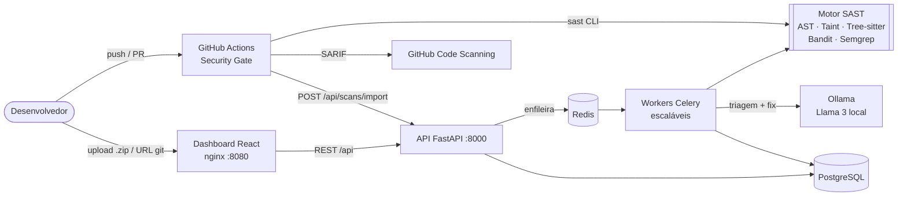

# 🛡️ SAST Sentinel — Plataforma SAST & DevSecOps

> Projeto Integrador · Engenharia de Software (3º ano) · FIAP 2026
> Prof. M.Sc. Oerton Fernandes

Plataforma de **Static Application Security Testing** que analisa código-fonte sem executá-lo, detecta vulnerabilidades com **regras determinísticas + taint analysis interprocedural**, usa um **LLM local (Ollama/Llama 3)** para triagem semântica e geração de correções **auto-verificadas**, e integra tudo a pipelines **CI/CD com Security Gates** que bloqueiam Pull Requests inseguros.

| | |
|---|---|
| **Linguagens** | **Python** (AST + taint interprocedural) · **Java** (Tree-sitter + taint intraprocedural) · **JavaScript** (regras Tree-sitter) · Go, PHP, C#, TypeScript, Kotlin, Ruby, Rust, C/C++, Swift, Scala via **fallback Semgrep** |
| **Motores** | AST próprio · Taint analysis · Tree-sitter · Bandit · Semgrep |
| **IA** | Ollama (Llama 3.x) local, ou qualquer API compatível com OpenAI (ex.: Groq) no deploy online: triagem, severidade, remediação verificada |
| **Backend** | FastAPI · PostgreSQL · Redis + Celery (assíncrono, escalável) |
| **Frontend** | React + Recharts (dashboard executivo) |
| **DevSecOps** | Docker Compose · GitHub Actions · SARIF · Gitleaks · pip-audit |
| **Relatórios** | **PDF para leitura humana** (resumo executivo, achados, detalhes e correções) · SARIF para ferramentas · Markdown no PR · JSON |
| **Precisão medida** | **96,2 % de precisão / 100 % de recall** em 50 vulnerabilidades anotadas, 3 linguagens ([benchmark](docs/BENCHMARK.md)) |
| **Acesso** | Login com sessão segura (scrypt, cookie HttpOnly/SameSite, bloqueio de força bruta), perfis admin/analista |

---

## Arquitetura



Detalhes (C4 nível 1 a 3, sequência de um scan e decisões de arquitetura): [docs/ARQUITETURA.md](docs/ARQUITETURA.md).

## Destaques técnicos

1. **Taint analysis interprocedural e entre arquivos**: rastreia o dado de `request.args` até `cursor.execute` passando por funções de outros módulos, com *resumos de função* calculados por ponto fixo ([docs/MOTOR_SAST.md](docs/MOTOR_SAST.md)).
2. **Sanitizadores por categoria**: `shlex.quote` neutraliza *command injection*, mas **não** SQL injection, e o motor sabe disso.
3. **Validação por allowlist**: `if x not in ALLOWED: abort()` é reconhecido como sanitização, o que reduz falsos positivos.
4. **Consenso entre motores**: achados confirmados por mais de um motor (AST + taint + Bandit) ganham confiança alta; o CWE do Bandit é normalizado para a mesma taxonomia.
5. **IA com guardrails**: o LLM pode ajustar a severidade em no máximo um nível e só marca falso positivo com confiança ≥ 0,8 (≥ 0,9 para fluxos de taint). A IA **nunca apaga** achados.
6. **Remediação auto-verificada**: o patch sugerido pelo LLM é aplicado em memória, recompilado e **reanalisado pelo próprio motor**; só é marcado como ✓ verificado se a vulnerabilidade desaparece.
7. **Security Gate com baseline**: só achados **novos** bloqueiam o PR, então a dívida técnica conhecida não trava o time. As decisões de triagem persistem entre scans.
8. **A plataforma se analisa (dogfooding)**: o próprio repositório passa pelo gate em todo PR. O gate já encontrou e bloqueou um SHA-1 no nosso código e um falso positivo da própria regra de segredos (`credentials: "same-origin"`), que virou correção + teste.
9. **Autenticação com boas práticas**: senhas com scrypt + salt, token de sessão em cookie `HttpOnly` + `SameSite=Strict` (só o hash fica no banco), bloqueio após 5 tentativas, mensagem idêntica para usuário inexistente, sem senha padrão e perfis admin/analista ([docs/SEGURANCA.md](docs/SEGURANCA.md)).

## Como rodar

### Opção 1: stack completa com Docker (recomendado)

```bash
cp .env.example .env          # defina POSTGRES_PASSWORD
docker compose up -d --build  # 1ª vez baixa o modelo do Ollama (~2 GB)
```

| Serviço | URL |
|---|---|
| Dashboard | http://localhost:8080 (login: `admin` + `ADMIN_PASSWORD` do `.env`) |
| API + Swagger | http://localhost:8000/docs |
| Ollama | http://localhost:11434 |

Para popular com um histórico de demonstração (gráfico de tendência):

```bash
docker compose exec api python -m app.seed --samples /opt/samples --days 10
```

Para escalar os workers: `docker compose up -d --scale worker=4`. Com GPU NVIDIA: `docker compose -f docker-compose.yml -f docker-compose.gpu.yml up -d`.

### Apresentar online (link público, plano gratuito)

O `Dockerfile.deploy` empacota **API + dashboard + SQLite em um único contêiner** (sem Redis, Postgres nem Ollama), que roda no plano gratuito do [Render](https://render.com) com ~150 MB de RAM. As análises rodam em segundo plano dentro do próprio processo e o histórico de demonstração é criado sozinho na subida.

1. Crie uma conta no Render entrando com o GitHub.
2. **New → Blueprint** → escolha este repositório. O `render.yaml` já configura tudo.
3. Quando ele pedir `LLM_API_KEY`, cole uma chave gratuita do [Groq](https://console.groq.com/keys) para ter a **IA funcionando online** (ou deixe em branco: a triagem cai para a heurística).
4. Em ~5 min o link `https://sast-sentinel-xxxx.onrender.com` está no ar (dashboard na raiz, Swagger em `/docs`).

> Plano gratuito: o serviço **dorme após 15 min sem acesso** e leva ~1 min para acordar; abra o link um pouco antes de apresentar. O disco é efêmero: scans feitos ao vivo somem quando ele reinicia, mas a demo volta sozinha.

A mesma imagem roda em qualquer lugar: `docker build -f Dockerfile.deploy -t sast-sentinel:deploy . && docker run -p 8000:8000 sast-sentinel:deploy`. A arquitetura completa (workers Celery, Postgres, Ollama local) continua sendo a Opção 1.

### Opção 2: desenvolvimento local (sem Docker)

```bash
pip install -e "engine[js,tools,dev]"
pip install -r services/api/requirements.txt

# API com SQLite e Celery síncrono (sem Redis)
cd services/api
DATABASE_URL=sqlite:///./demo.db CELERY_EAGER=1 python -m app.seed --days 10
DATABASE_URL=sqlite:///./demo.db CELERY_EAGER=1 uvicorn app.main:app --port 8000

# Dashboard (outro terminal)
cd dashboard && npm install && npm run dev   # http://localhost:5173
```

### Opção 3: apenas a CLI

```bash
pip install -e "engine[js,tools]"
sast scan samples/vulnerable_app -v                 # relatório no terminal + gate
sast scan . --sarif out.sarif --markdown out.md     # relatórios
sast scan . --pdf relatorio.pdf                      # relatório em PDF (pip install "engine[pdf]")
sast scan . --ai                                    # triagem com LLM local (requer Ollama)
sast baseline . -o .sast-baseline.json              # congela a dívida técnica atual
sast benchmark samples                              # precisão/recall vs. gabarito
sast rules                                          # catálogo de regras
```

Código de saída: `0` = gate aprovado, `1` = gate reprovado (é isso que bloqueia o pipeline).

## Integração CI/CD

- [`.github/workflows/security-gate.yml`](.github/workflows/security-gate.yml) roda **SAST com gate**, publica o SARIF no GitHub Code Scanning, comenta o resumo no PR e envia o resultado ao dashboard. Também roda **Gitleaks** (segredos), **pip-audit/npm audit** (SCA) e uma demonstração de que o gate bloqueia o código vulnerável.
- [`.github/workflows/ci.yml`](.github/workflows/ci.yml) roda testes do motor (cobertura ≥ 80 %), benchmark, testes da API, build do dashboard e smoke test da stack Docker.
- [`action.yml`](action.yml) é uma **GitHub Action reutilizável**, para que qualquer repositório use o SAST Sentinel com `uses: vitormusolino/sast-sentinel@main`.

Para **bloquear o merge** de fato: *Settings → Branches → Branch protection → Require status checks → `SAST Sentinel (gate)`*. Detalhes em [docs/DEVSECOPS.md](docs/DEVSECOPS.md).

## Estrutura

```
engine/                 Motor SAST (pacote Python + CLI `sast`)
  sast_engine/
    parsers/            AST Python (aliases de import) e Tree-sitter (JS)
    rules/              Catálogo (CWE/OWASP) e 16 regras Python
    taint/              Taint analysis intra/interprocedural
    ai/                 Cliente Ollama, triagem com guardrails, verificação de patch
    integrations.py     Bandit e Semgrep (normalização + consenso)
    gate.py             Security Gate (política, baseline)
    reporting.py        SARIF 2.1.0, Markdown, JSON, terminal
    benchmark.py        Precisão/recall contra gabarito
  tests/                62 testes (cobertura 84 %)
services/api/           FastAPI + Celery + SQLAlchemy (12 testes de integração)
dashboard/              React + Vite + Recharts
samples/                Corpus de teste (código próprio): vulnerável, seguro e casos difíceis
docs/                   Arquitetura, motor, IA, DevSecOps, benchmark e roteiro de defesa
```

## Mapa de entregas (CP1 → CP3)

| Checkpoint | Entrega pedida | Onde está |
|---|---|---|
| CP1 | Diagrama de arquitetura técnica (C4) | [docs/ARQUITETURA.md](docs/ARQUITETURA.md) |
| CP1 | Repositório com Docker Compose | [docker-compose.yml](docker-compose.yml) |
| CP1 | Parser de código funcional | [engine/sast_engine/parsers](engine/sast_engine/parsers) |
| CP1 | Detecção de 3 violações iniciais | 16 regras Python + 5 JS ([catálogo](engine/sast_engine/rules/catalog.py)) |
| CP2 | Módulo de taint analysis | [engine/sast_engine/taint](engine/sast_engine/taint) |
| CP2 | Integração com LLM local | [engine/sast_engine/ai](engine/sast_engine/ai) |
| CP2 | Sugestões de remediação | catálogo + LLM com verificação automática |
| CP2 | Demo de varredura semântica | `sast scan samples --ai -v` · [docs/DEFESA.md](docs/DEFESA.md) |
| CP3 | Integração CI/CD com Security Gates | [.github/workflows](.github/workflows) · [action.yml](action.yml) |
| CP3 | Dashboard e relatórios analíticos | [dashboard/](dashboard) · SARIF/Markdown/JSON |
| CP3 | Documentação e defesa técnica | [docs/](docs) · [docs/DEFESA.md](docs/DEFESA.md) |

## Ética e propriedade intelectual

Todo o código em `samples/` foi escrito pelo grupo **especificamente** para testar a ferramenta. Ele não contém código de terceiros, e os segredos são falsos (por exemplo, a chave de exemplo da documentação da AWS). A plataforma aceita apenas repositórios via HTTPS de hosts em uma *allowlist* e deve ser usada somente em código próprio ou open source com licença que permita a análise.

## Equipe

| Nome | RM |
|---|---|
| Fernando Alexandre | RM555045 |
| Gabriel Vallejo | RM554973 |
| Lucas Catroppa | RM555450 |
| Luiz Felipe | RM555074 |
| Vitor Musolino | RM555012 |
