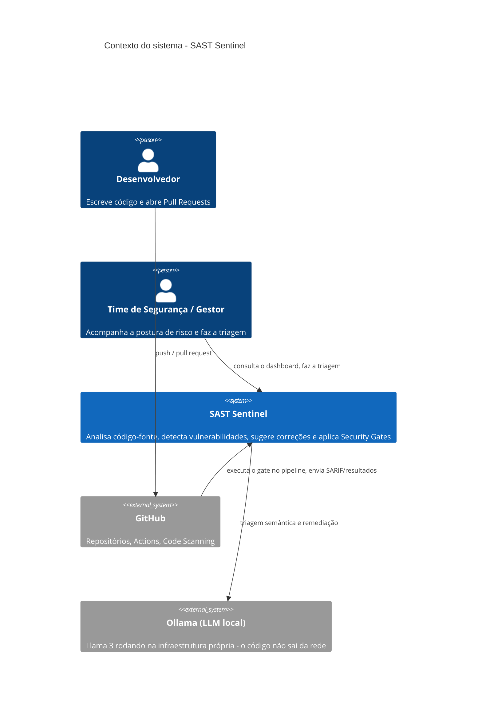
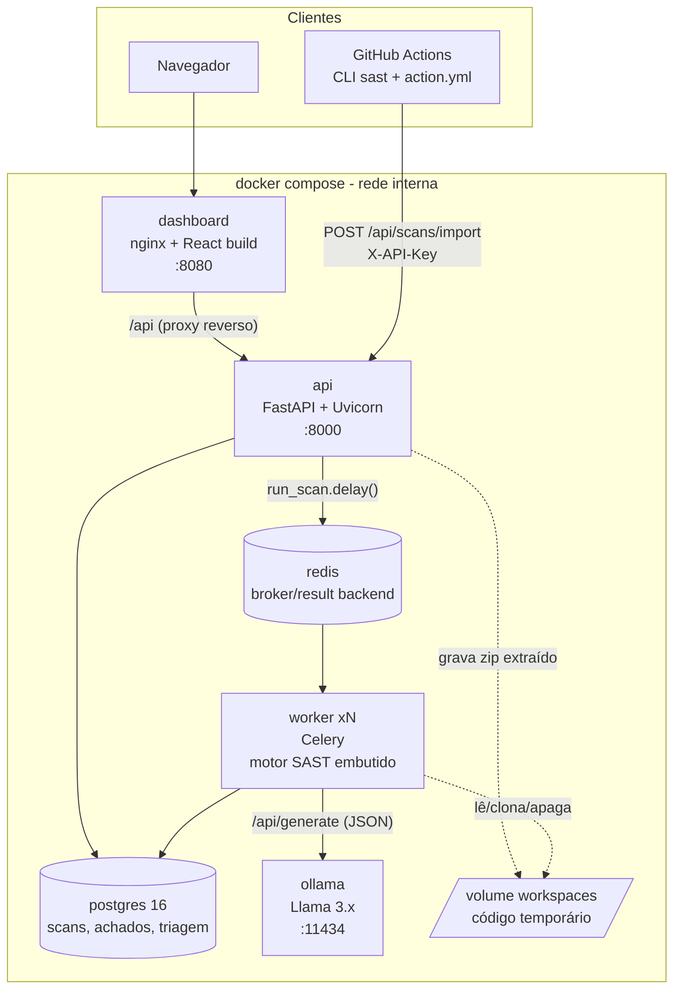
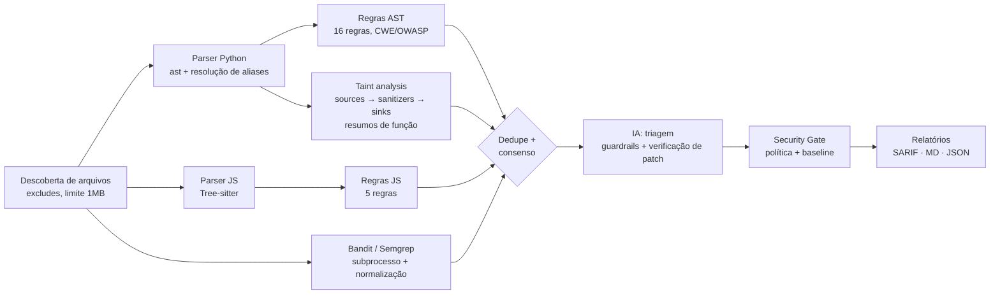
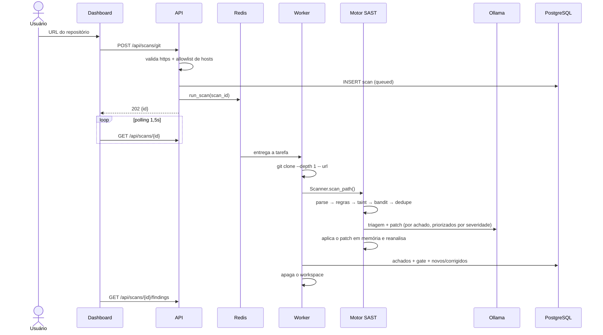
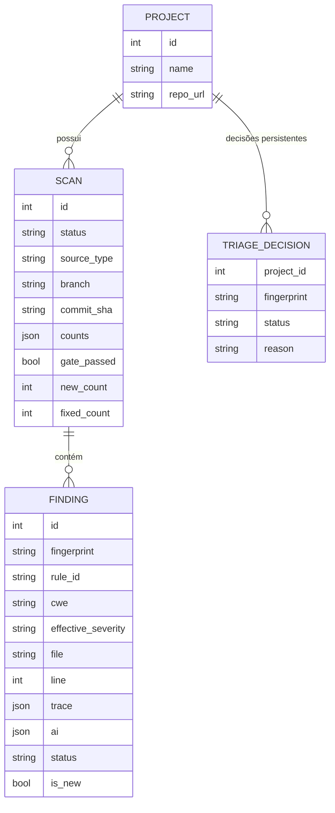

# Arquitetura técnica — SAST Sentinel

Modelo **C4** (Contexto → Contêineres → Componentes), sequência de um scan e decisões de arquitetura.

## Nível 1: Contexto

**Por que LLM local?** O código-fonte é um ativo sensível. Mandá-lo para uma API externa violaria a confidencialidade e a propriedade intelectual que o próprio enunciado pede para respeitar. Com o Ollama o código nunca sai da infraestrutura.

## Nível 2: Contêineres

| Contêiner | Tecnologia | Responsabilidade | Escala |
|---|---|---|---|
| `dashboard` | React 18, Recharts, nginx | UI executiva e de triagem; proxy `/api`; cabeçalhos de segurança (CSP) | stateless |
| `api` | FastAPI, SQLAlchemy 2 | REST, validação de upload/URL, enfileiramento, métricas agregadas | horizontal (stateless) |
| `worker` | Celery 5 | clona/extrai código, roda o motor, consulta o LLM, persiste | `--scale worker=N` |
| `redis` | Redis 7 (AOF) | fila de tarefas (`scans`) | — |
| `postgres` | PostgreSQL 16 | projetos, scans, achados, decisões de triagem | — |
| `ollama` | Ollama + Llama 3.2 3B (padrão) | inferência local, opcionalmente em GPU | GPU/CPU |

**Processamento assíncrono:** a API responde `202 Accepted` em milissegundos e o trabalho pesado (git clone, parsing, LLM) fica nos workers. O `task_acks_late` com `prefetch=1` garante que um scan não se perca se um worker cair, e que tarefas longas não fiquem presas atrás de outras.

## Nível 3: Componentes do motor (`engine/sast_engine`)

| Componente | Arquivo | Papel |
|---|---|---|
| Parser Python | `parsers/python_parser.py` | AST da stdlib; resolve `from os import system as run` para `os.system`; coleta `# nosec` |
| Parser JS | `parsers/js_parser.py` | CST Tree-sitter; regras sobre nós `call_expression`, `assignment_expression`... |
| Regras | `rules/python_rules.py`, `rules/catalog.py` | `NodeVisitor` com filtros anti-FP (literal constante, nomes de campo, placeholders) |
| Taint | `taint/python_taint.py` | Análise de fluxo de dados sensível à ordem; interprocedural via resumos |
| Integrações | `integrations.py` | Bandit/Semgrep, normalização de CWE, filtro de ruído |
| IA | `ai/analyzer.py`, `ai/llm.py` | Prompt estruturado, guardrails, verificação de patch, fallback heurístico |
| Gate | `gate.py` | Política (`fail_on`, `max_counts`, confiança mínima), baseline |
| Relatórios | `reporting.py` | SARIF 2.1.0 com `codeFlows` (o caminho do taint aparece no GitHub) |

## Sequência: scan disparado pelo dashboard

## Modelo de dados

O **fingerprint** (`sha1(regra | arquivo | trecho normalizado)`) não depende do número da linha. Por isso um achado continua sendo "o mesmo" quando o código acima dele muda, e é isso que viabiliza:
- **novos × corrigidos** entre scans consecutivos;
- **baseline** no CI (só achados novos bloqueiam);
- **triagem persistente** (um falso positivo marcado uma vez não volta).

## Decisões de arquitetura (ADRs resumidos)

| # | Decisão | Alternativas | Motivo |
|---|---|---|---|
| 1 | Python como linguagem-alvo principal | JS, Java | `ast` da stdlib é preciso e estável, o ecossistema SAST (Bandit/Semgrep) é maduro e o taint fica mais confiável |
| 2 | Motor próprio + ferramentas externas | Só Bandit/Semgrep | As ferramentas prontas não fazem taint interprocedural entre arquivos nem verificam correções. Usamos as externas como segunda opinião (consenso) |
| 3 | Celery + Redis | BackgroundTasks do FastAPI | Scans longos não podem bloquear a API; workers escalam e sobrevivem a falhas (`acks_late`) |
| 4 | LLM local (Ollama) | OpenAI/Claude API | Confidencialidade do código; custo zero por chamada; funciona offline |
| 5 | IA como *triagem*, nunca como *filtro* | Deixar o LLM decidir | LLMs alucinam. Os guardrails limitam o impacto: severidade ±1, FP só com alta confiança, achado nunca é apagado |
| 6 | SARIF 2.1.0 | Formato próprio | Padrão OASIS, aceito pelo GitHub Code Scanning, VS Code e Azure DevOps |
| 7 | Monorepo | Repositórios separados | Um único `docker compose up`; versionamento conjunto de motor, API e UI |
| 8 | Fingerprint sem número de linha | `arquivo:linha` | Estabilidade entre commits (baseline, novos/corrigidos, triagem) |

## Segurança da própria plataforma

Uma ferramenta de segurança que recebe código arbitrário também é um alvo:

| Ameaça | Mitigação |
|---|---|
| Zip Slip / zip bomb | Rejeita caminhos absolutos e `..`, ignora symlinks, limita o número de arquivos e o tamanho descompactado (`workspace.py`) |
| SSRF / injeção de argumentos via URL git | Apenas `https://`, allowlist de hosts, sem credenciais na URL, `--` antes da URL, branch validada por regex |
| Execução de código analisado | O motor **nunca executa** o código: só faz parsing |
| Abuso do endpoint de ingestão | `X-API-Key` obrigatório em `/api/scans/import` |
| Escalada no contêiner | Usuário sem privilégios (`uid 10001`), imagem slim |
| XSS no dashboard | React escapa por padrão; CSP restritiva e `X-Frame-Options: DENY` no nginx |
| Vazamento do código para terceiros | LLM local; nenhuma chamada externa |
| Dependências vulneráveis | `pip-audit` e `npm audit` no pipeline; Gitleaks para segredos |
