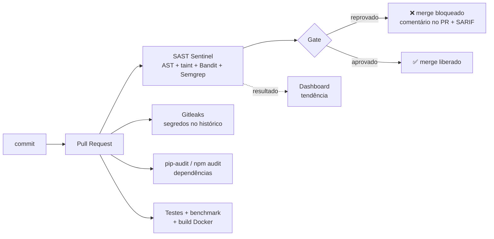

# DevSecOps: pipelines e Security Gates

## Shift-left na prática



## Workflows

### `security-gate.yml` (todo PR e push na `main`)
| Job | O que faz | Bloqueia? |
|---|---|---|
| **SAST Sentinel (gate)** | `sast scan . --bandit --semgrep` com a política do `.sast.yml`; gera SARIF, JSON e Markdown; publica no **Code Scanning**; comenta (e atualiza) o resumo no PR; envia ao dashboard se `SAST_API_URL` estiver configurado | **sim** |
| **Gitleaks** | segredos em **todo o histórico** do Git (`fetch-depth: 0`) | sim |
| **SCA** | `pip-audit` nas dependências Python e `npm audit --audit-level=high` no dashboard | sim |
| **Demonstração** | prova que o gate **reprova** `samples/vulnerable_app` e **aprova** `samples/safe_app`; se o gate parar de bloquear, este job falha | sim |

### `ci.yml`
Testes do motor com cobertura mínima de 80 %, benchmark (publicado no *job summary*), testes de integração da API, build do dashboard, build das imagens e **smoke test** da stack (`docker compose up` + `/api/health`).

## Política do gate (`.sast.yml`)

```yaml
gate:
  fail_on: HIGH                       # qualquer HIGH/CRITICAL novo bloqueia
  max_counts: { MEDIUM: 5 }           # mais de 5 MEDIUM também bloqueia
  min_confidence: MEDIUM              # ignora achados de baixa confiança
  ignore_likely_false_positives: true # respeita a triagem da IA
  baseline: .sast-baseline.json       # só achados NOVOS bloqueiam
```

**Baseline (adoção gradual):** em um projeto legado com 300 achados, bloquear todo PR travaria o time e o gate acabaria desligado. Com `sast baseline . -o .sast-baseline.json` congelamos a dívida atual. A partir daí, só o que for **introduzido** no PR bloqueia, enquanto a dívida antiga é paga aos poucos e aparece no dashboard.

**Supressão auditável:** `# nosec - justificativa` na linha. Fica no código, passa por code review e aparece em `git blame`.

## Bloqueando o merge de verdade
1. *Settings → Branches → Add branch protection rule* para `main`;
2. marque **Require status checks to pass before merging**;
3. selecione `SAST Sentinel (gate)`, `Varredura de segredos (Gitleaks)` e `Dependências vulneráveis (SCA)`.

## Usar em outro repositório (Action reutilizável)

```yaml
# .github/workflows/sast.yml em qualquer repositório
on: pull_request
jobs:
  sast:
    runs-on: ubuntu-latest
    permissions: { contents: read, security-events: write }
    steps:
      - uses: actions/checkout@v4
      - uses: vitormusolino/sast-sentinel@main
        with:
          fail-on: HIGH
          upload-url: ${{ secrets.SAST_API_URL }}
      - uses: github/codeql-action/upload-sarif@v3
        if: always()
        with: { sarif_file: sast.sarif }
```

## Relatórios gerados

| Formato | Uso |
|---|---|
| **PDF** | relatório para pessoas: resumo executivo, gate, achados por severidade, detalhes com código, caminho do taint, correção e análise da IA; botão no dashboard e artefato `sast-relatorio.pdf` em todo PR |
| **SARIF 2.1.0** | GitHub Code Scanning (alertas inline no PR), VS Code (SARIF Viewer). Inclui `codeFlows`, então o caminho do taint aparece passo a passo no GitHub |
| **Markdown** | comentário no PR e `$GITHUB_STEP_SUMMARY` |
| **JSON** | integração com outras ferramentas e upload para o dashboard |
| **Terminal** | uso local pelo desenvolvedor |

## Dogfooding
O próprio repositório passa pelo gate. Na primeira execução ele **bloqueou o nosso código** por um `hashlib.sha1` no cálculo do fingerprint (uso não criptográfico, corrigido com `usedforsecurity=False`) e apontou um diretório `/tmp` fixo. Os achados restantes eram falsos positivos do Bandit, suprimidos com justificativa.
