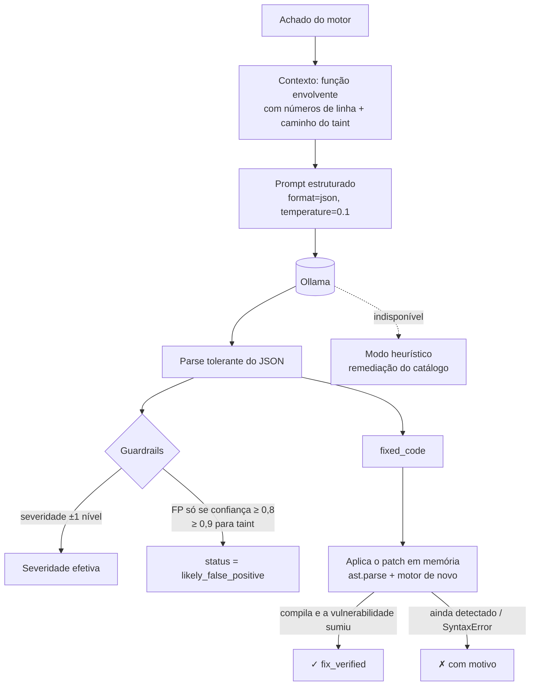

# Módulo de IA: triagem semântica e remediação verificada

## Objetivo
Regras e taint são **determinísticos**: precisos no que modelam, mas sem entender *intenção*. O LLM complementa com:
1. **Classificação de severidade contextual** (é rota pública? há validação? é arquivo de teste?);
2. **Redução de falsos positivos** em lógicas que o motor não modela (ex.: validação via `urlparse`);
3. **Remediation Advice**: explicação, cenário de exploração e **bloco de código corrigido**;
4. **Resumo executivo** do scan para gestores.

## Por que Ollama + Llama 3 local
- **Confidencialidade**: o código não sai da infraestrutura. Uma ferramenta de segurança não pode vazar o código que protege.
- **Custo zero por chamada** e funcionamento offline.
- **Modelo configurável** (`OLLAMA_MODEL`): `llama3.2:3b` roda em CPU (padrão); `llama3.1:8b` ou `qwen2.5-coder:7b` dão respostas melhores com mais RAM/GPU.

## Pipeline por achado



### Prompt (resumo)
O prompt envia: regra, CWE/OWASP, severidade da regra, mensagem, **o caminho do taint passo a passo** e a **função envolvente com números de linha**, com a linha do achado marcada (`>>`). Ele pede um JSON com: `is_false_positive`, `confidence`, `severity`, `explanation`, `exploit_scenario`, `fixed_code` (o trecho completo reescrito) e `references`. Usamos `format: "json"` do Ollama e `temperature 0.1` para respostas estáveis, e um *parser* tolerante extrai o JSON mesmo quando modelos pequenos o envolvem em Markdown.

### Guardrails: por que a IA não decide sozinha
LLMs alucinam. Se o modelo pudesse "apagar" achados, um único erro esconderia uma SQL Injection real. Por isso:

| Regra | Efeito |
|---|---|
| Severidade só muda **±1 nível** | um CRITICAL nunca vira INFO por alucinação |
| FP exige confiança ≥ 0,8 (≥ 0,9 se o motor provou o fluxo source→sink) | fluxos comprovados são mais difíceis de descartar |
| Achado nunca é removido | vira `likely_false_positive`; o gate ignora por padrão (configurável) e a decisão humana prevalece |
| Prioridade por severidade e limite de chamadas (`max_findings`) | o custo é controlado e os críticos são revisados primeiro |
| Cache por hash do prompt | o mesmo achado não é reprocessado |

### Remediação auto-verificada (diferencial)
Sugestões de correção de LLM costumam (a) não compilar ou (b) não corrigir de fato. Por isso **verificamos cada patch**:
1. substituímos as linhas da função original pelo `fixed_code` (tentando também reindentar);
2. fazemos `ast.parse`: se não compila, o patch é recusado com o motivo "SyntaxError";
3. rodamos **regras + taint de novo** no arquivo corrigido: se a mesma regra/CWE ainda aparece na região, o patch é marcado ✗ com o motivo ("o motor ainda detecta TAINT-CMDI na linha 6");
4. só então o dashboard exibe **✓ verificado pelo motor**.

É o motor determinístico servindo de **oráculo** para a IA generativa: um faz o que o outro não faz bem.

### Desempenho medido (CPU, 6 núcleos, `llama3.2:3b`)
| Configuração | Tempo do scan |
|---|---|
| 29 achados revisados pelo LLM | ~22 min |
| 10 achados (padrão `AI_MAX_FINDINGS=10`, os mais graves) | ~11 min |
| Re-scan do mesmo código (cache `LLM_CACHE_DIR`) | ~5 s |

No primeiro teste real, o modelo de 3B copiava a severidade do exemplo do prompt e alterou a severidade de 29 de 29 achados. Trocamos o exemplo por placeholders, pedimos explicitamente para manter a severidade da regra sem motivo concreto e proibimos rebaixar fluxos de taint comprovados: as alterações caíram para 0.

### Fallback heurístico
Sem Ollama (CI sem GPU, máquina fraca), a plataforma **não quebra**: usa a remediação e o exemplo de correção do catálogo, reduz a severidade de achados em arquivos de teste e eleva a confiança de achados confirmados por vários motores. O modo usado aparece em cada achado (`ai.mode`).

## Como demonstrar
```bash
docker compose up -d ollama ollama-pull        # baixa o modelo
OLLAMA_URL=http://localhost:11434 sast scan samples/vulnerable_app --ai -v
```
No dashboard, abra um achado CRITICAL: veja "Análise da IA", "Código corrigido sugerido" e o selo **✓ verificado pelo motor**.

## Como avaliamos a IA
- `tests/test_scanner_gate_ai.py` usa um LLM *fake* determinístico para provar os guardrails (FP com 0,85 em taint **não** é aceito; a severidade proposta INFO vira HIGH, ou seja, -1 nível) e a verificação (um patch real é aceito, um patch falso é recusado, um patch quebrado dá SyntaxError).
- Métricas no dashboard: achados revisados por LLM, prováveis FP e correções verificadas.
